# Project Room

**Your agent builds the app. You keep the controls.**

Build in Codex, Claude Code, Cursor, or your usual editor. Project Room opens the **same local repository** and gives you one window to run the app, check tests, inspect data, and follow the product plan. It is a free, open-source macOS desktop app for people building software with coding agents and the teammates who need to understand that software later.

[**Download free for Mac**](https://github.com/OpenProjectRoom/desktop/releases/latest/download/Project-Room-Desktop-arm64-mac.zip) · [Watch the 52-second walkthrough](assets/demo/project-room-walkthrough.mp4) · [Explore the website tour](https://openprojectroom.com/#live-tour) · [Read the agent guide](agent/project-room/SKILL.md)

[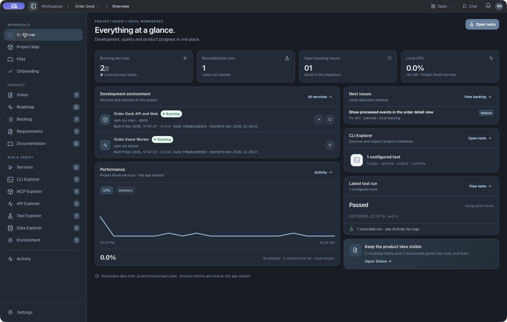](assets/screenshots/order-desk-overview.png)

*A real local Order Desk project opened in Project Room. The two services were started manually, the test result came from an actual run, and the CPU history was sampled during this app session. Click any screenshot in this README for its full size.*

## See the workflow in 52 seconds

[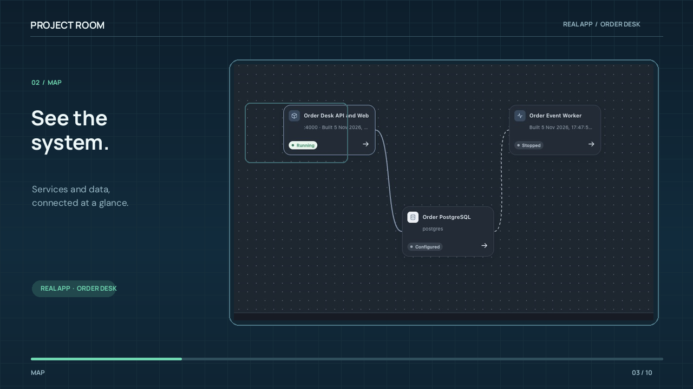](assets/demo/project-room-walkthrough.mp4)

[Play or download the MP4](assets/demo/project-room-walkthrough.mp4). This silent walkthrough uses captured screens from **Order Desk**, a separate sample application built to exercise Project Room's Spec Kit, service, API, PostgreSQL, CLI, MCP, and test views. The film animates those captures; the website's [interactive tour](https://openprojectroom.com/#live-tour) is a labeled simulation. Neither is a recording of unattended agent actions.

## One repository, two ways to work

Your coding agent edits the code and [GitHub Spec Kit](https://github.com/github/spec-kit) files in the repository. Project Room reads that same repository, shows its product context, and runs **verified local commands only when you click**. It is a control surface beside your editor, with no need to move your code or specifications.

    You → Codex / Claude Code / Cursor → shared Git repository
                                          ↕
                                  Project Room Desktop
                                          ↓
                             Local services · tests · data

| You want to… | Open… | What you see or do |
| --- | --- | --- |
| Get your bearings | **Overview**, **Files**, **Onboarding** | Current services, recorded test runs, backlog, repository files, and which setup entries were actually found. |
| Keep the product direction visible | **Vision**, **Roadmap**, **North Star**, **Backlog**, **Documentation** | Markdown product context and repository-backed work. Vision, Roadmap, and North Star are optional navigation views. |
| Follow a Spec Kit feature | **Requirements** | Constitution, spec, plan, tasks, task checkboxes, requirement IDs, and links to configured components and recorded tests. |
| Understand and run the local stack | **Project Map**, **Services** | Services, databases, storage, dependencies, start/stop controls, logs, build identity, and CPU/memory history. |
| Explore interfaces | **API Explorer**, **MCP Explorer**, **CLI Explorer** | OpenAPI operations and responses; MCP tools, resources, and prompts; command help, arguments, and local output. |
| Inspect and verify | **Data Explorer**, **Test Explorer**, **Activity** | Read-only data previews, test suites and individual supported cases, plus recorded workspace events. |
| Set local values | **Environment** | Required variable names and values in the project's ignored <code>.env</code>; secrets stay out of the shared YAML. |

Product Chat is optional: connect a locally installed Codex CLI or Claude Code setup to ask about the open project. Your normal coding agent and editor remain your primary development tools.

## Follow the product from intent to evidence

Project Room keeps the *why* visible beside the running software. The product owner can edit a vision, maintain a local backlog and roadmap, and record one North Star outcome. The coding agent and developers can read the same files in Git.

[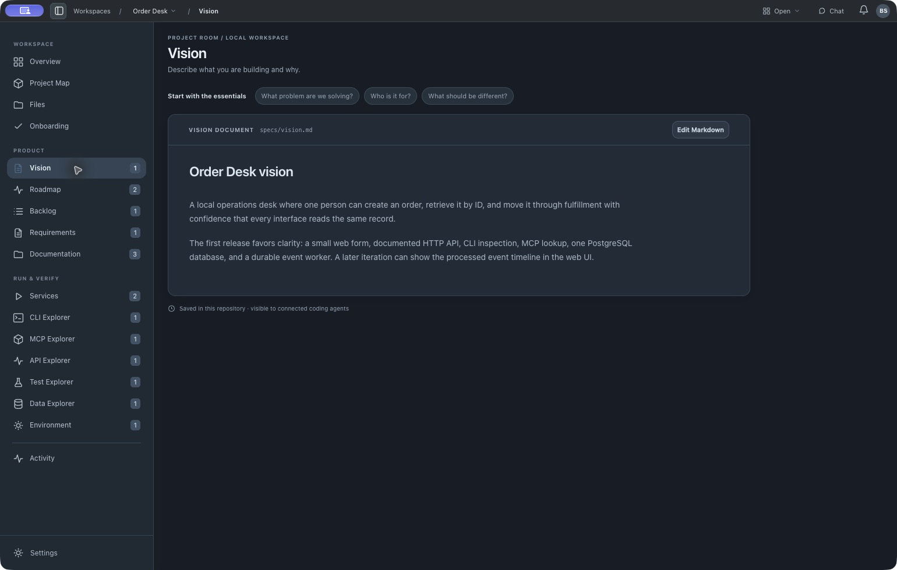](assets/screenshots/order-desk-vision.png)

**Spec Kit stays in its standard files.** Project Room reads <code>.specify/</code> and <code>specs/</code> rather than creating a parallel specification tree. Requirements shows the feature artifacts and task progress; optional YAML links connect requirement IDs to real components and test suites. A checked task is not treated as proof that a service is running or a requirement passes.

[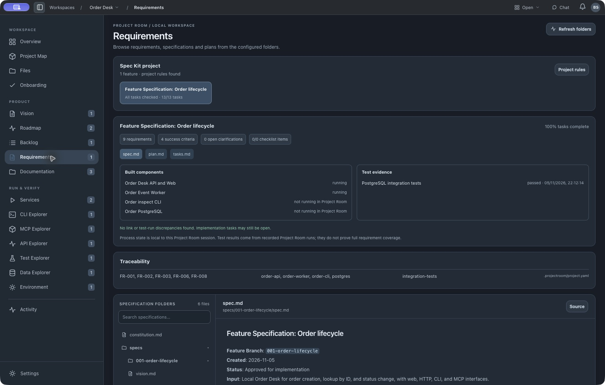](assets/screenshots/order-desk-requirements.png)

## See and operate the local system

The Project Map contains runtime resources: services, databases, storage, and persistent command servers. Tests, specifications, and backlog items have their own views. Services start manually and show the command, current process state, build timestamp, commit, optional version, and output.

[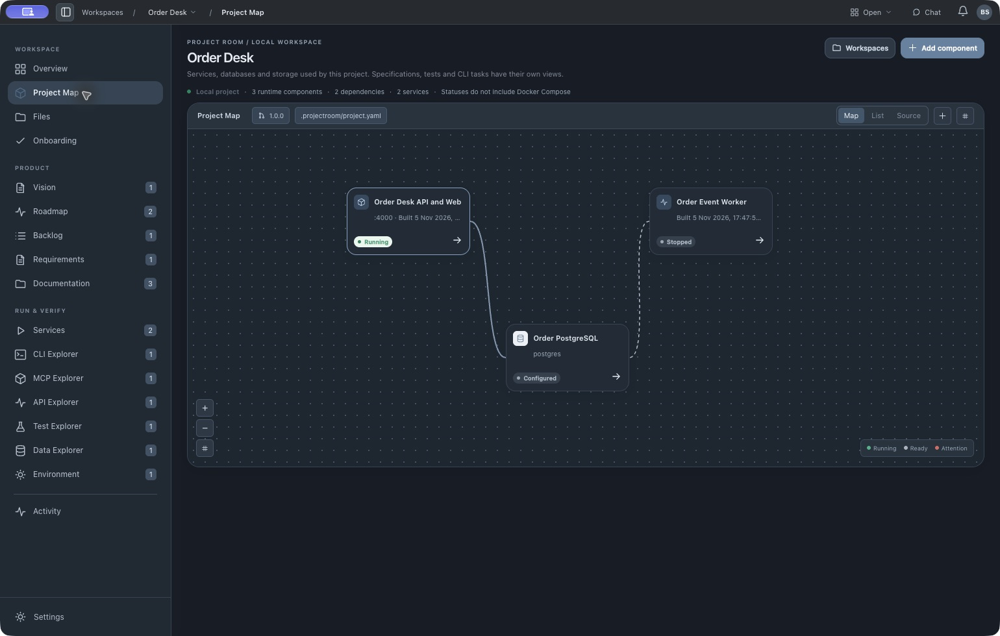](assets/screenshots/order-desk-project-map.png)

Project Room samples CPU and resident memory for services it starts, including child processes, every five seconds. The Overview combines their usage; Services shows a selected service's history. **Measurements live only in memory for this app session** and do not measure external processes, detached containers, disk usage, or API latency.

[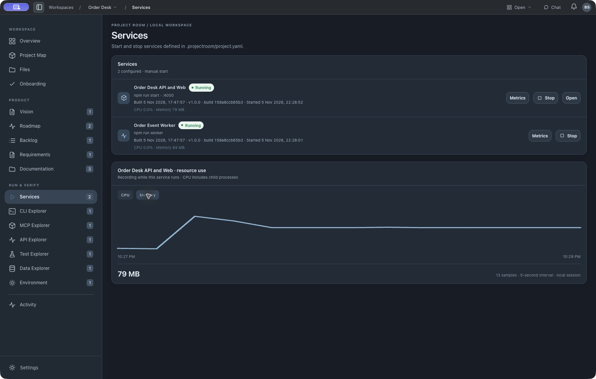](assets/screenshots/order-desk-services.png)

## Inspect the same application through every interface

In the Order Desk sample, the HTTP API, PostgreSQL tables, CLI command, and MCP tool all read the same order. Project Room makes each interface inspectable without treating one successful response as proof of every requirement.

| API Explorer | Data Explorer |
| --- | --- |
| [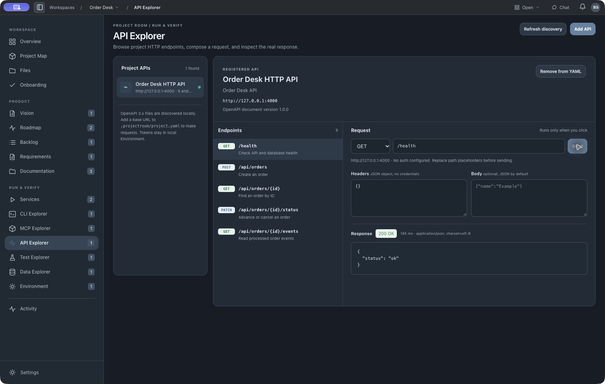](assets/screenshots/order-desk-api.png) | [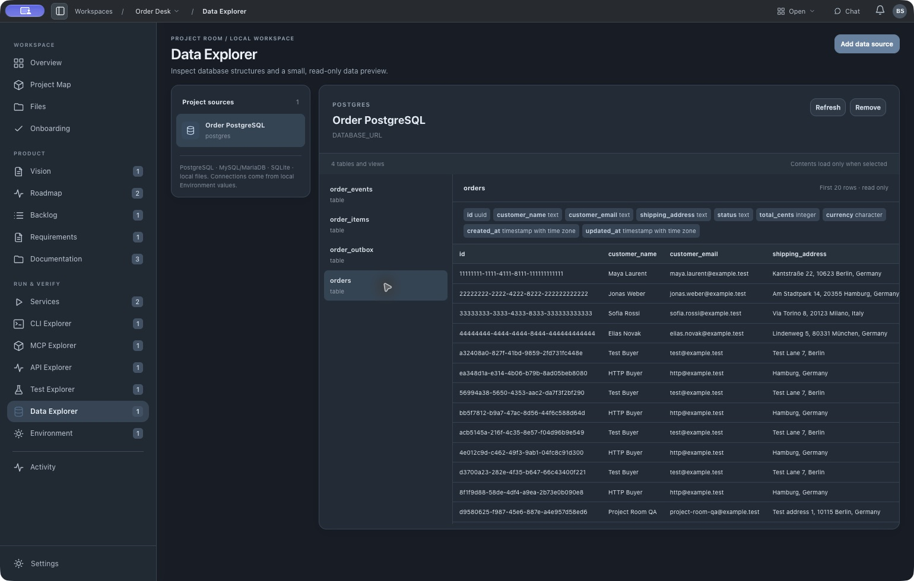](assets/screenshots/order-desk-data.png) |
| Discover OpenAPI files, inspect operations and schemas, compose a request, and send it explicitly. | Inspect PostgreSQL, MySQL/MariaDB, SQLite, or local files with small, read-only previews. |

| CLI Explorer | MCP Explorer |
| --- | --- |
| [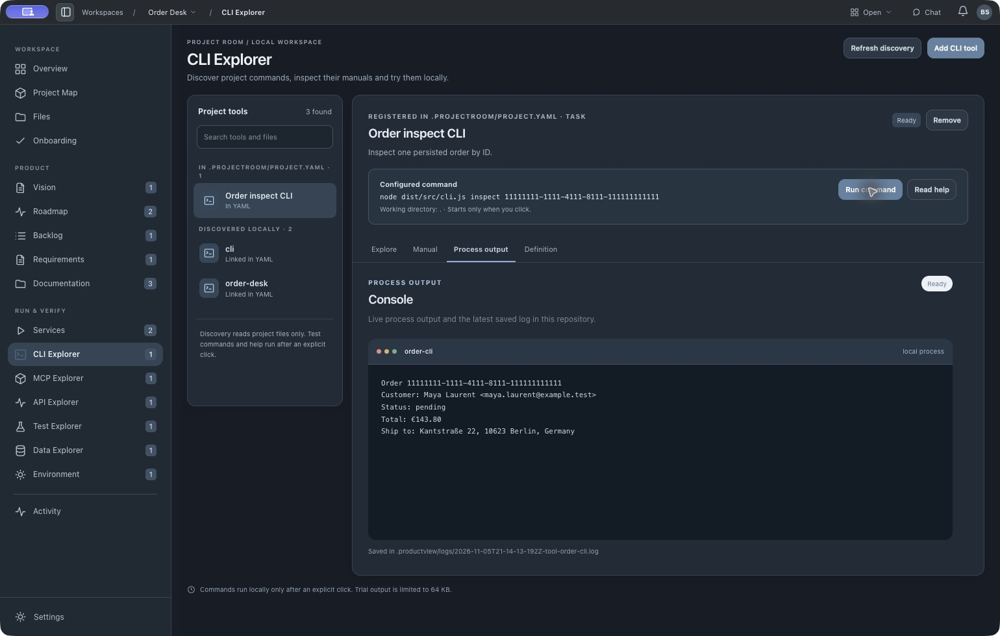](assets/screenshots/order-desk-cli.png) | [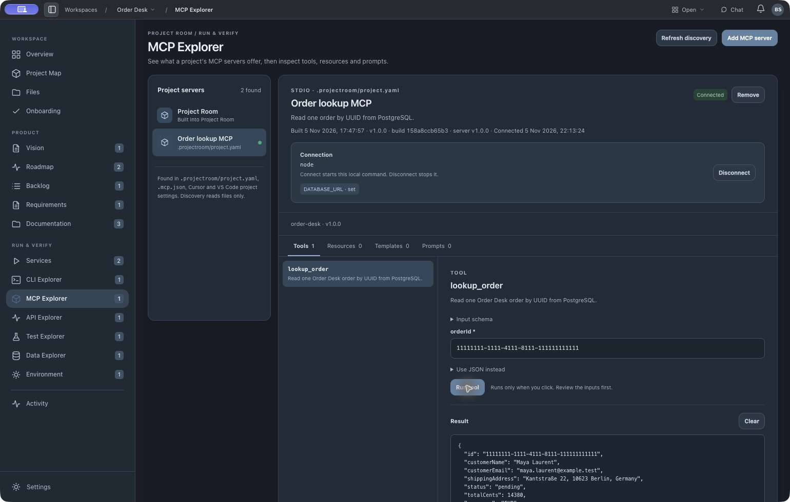](assets/screenshots/order-desk-mcp.png) |
| Discover likely project commands, read help on request, and run a bounded local trial after reviewing arguments. | Connect project MCP servers on request, browse advertised tools/resources/prompts, inspect schemas, and invoke an item deliberately. |

Test Explorer runs a configured suite or a supported individual Node/Rust test entry, then keeps the actual exit status and output. Its result is evidence of that command, not a fabricated coverage percentage.

[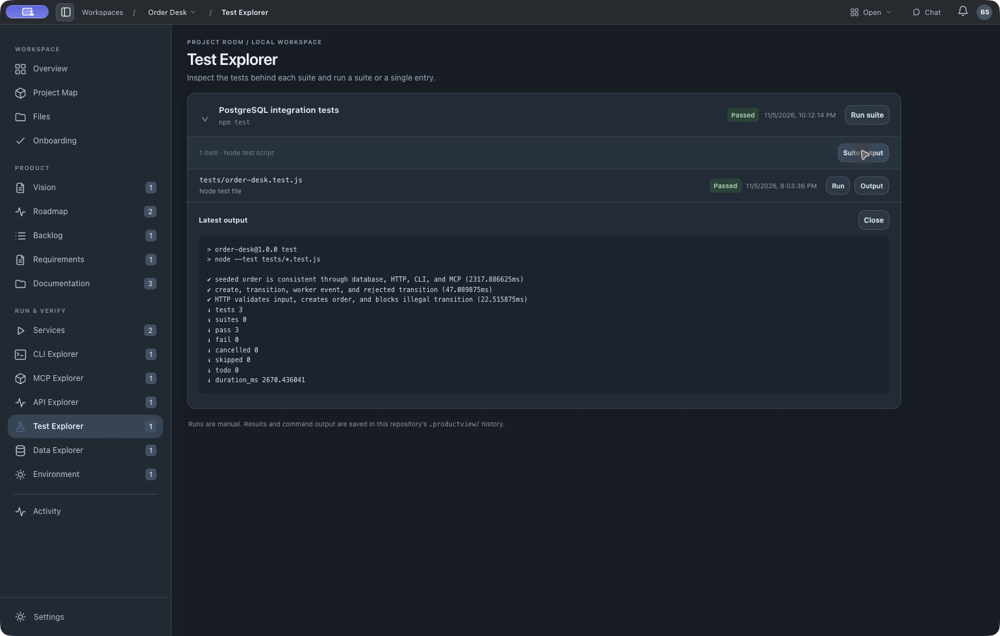](assets/screenshots/order-desk-tests.png)

## Start with the included working example

1. Download the [Apple Silicon Mac preview](https://github.com/OpenProjectRoom/desktop/releases/latest/download/Project-Room-Desktop-arm64-mac.zip), unzip it, and move **Project Room.app** to Applications. The preview is unsigned and unnotarized; macOS may require an explicit open in **System Settings → Privacy & Security**.
2. Open Project Room and choose **Try working example**. It copies a small project to <code>~/Documents/Project Room Examples/hello-workspace</code> and opens it without starting a process.
3. With [Node.js 20+](https://nodejs.org/) installed, start **Notes web service**, inspect its API and JSON storage, run **Node endpoint tests**, and open the linked Spec Kit feature in **Requirements**. Node is needed for this example's commands, not for the desktop app itself.

The [included example](examples/hello-workspace) has a real service, tests, local JSON storage, a constitution, and Spec Kit feature files. It needs no account, database server, or cloud deployment. The separate **Order Desk** screenshots above show a richer project with PostgreSQL, CLI, and MCP interfaces; Order Desk is not bundled with the desktop download.

## Open your own repository

Project Room's shared configuration is <code>.projectroom/project.yaml</code>, committed with your code. It points to **real** commands and resources; each developer keeps secret values in the project's ignored <code>.env</code>. Project Room scans an existing folder for clues, and a coding agent can prepare the YAML after inspecting the repository. Open **Onboarding** to see what was found, then verify service, test, and data connections yourself. Configured does not mean running or tested.

There are two short prompts on the [Get started page](https://openprojectroom.com/#get-started): one for a new Git + Spec Kit + Project Room project, and one for adding Project Room to a repository you already have. Paste the matching prompt into the coding agent **working in that project folder**. Both point to the [agent guide](agent/project-room/SKILL.md) and [YAML schema](schemas/projectroom.schema.json).

New project: the short path

Ask your agent to build your app with Git, the [official GitHub Spec Kit](https://github.com/github/spec-kit), and Project Room. Have it ask who the app is for and what the first useful release should do. Tell it to read the [guide](agent/project-room/SKILL.md) and [schema](schemas/projectroom.schema.json), keep Spec Kit artifacts in their standard files, and create <code>.projectroom/project.yaml</code> only from verified code and commands. Ask for the exact folder to open and the first service, test, and data source to check.

Existing project: the short path

Ask the agent already working in your repository to read the [guide](agent/project-room/SKILL.md) and [schema](schemas/projectroom.schema.json), inspect the actual code, scripts, specs, tests, APIs, data sources, MCP/CLI tools, and environment variable **names**, then create or update <code>.projectroom/project.yaml</code>. Keep the current project and Spec Kit structure. Validate the YAML; do not invent components, put secrets in Git, or start services during setup. Open the reported folder in Project Room and check the configured entries.

Existing root-level <code>productview.yaml</code> files still open for migration. New projects use <code>.projectroom/project.yaml</code> and should keep only one configuration file. See the [repository contract](PROJECT_ROOM.md) for the full configuration and current behavior.

## Current boundaries

Project Room is a **local development workspace**, not a cloud deployment platform. Processes, requests, tests, MCP connections, and data inspection require deliberate actions. The packaged browser demo and website tour use labeled sample data. Live GitHub/Linear issue synchronization, external telemetry adapters, database editing, and arbitrary SQL are not part of the current preview. The first public macOS builds are unsigned; Windows and Linux packages have not been tested.

## Develop and contribute

    npm ci
    npm test
    npm run validate:config
    npm start

On Apple Silicon macOS, <code>npm run package:mac:app</code> builds an app bundle. Read [CONTRIBUTING.md](CONTRIBUTING.md) before a pull request; use [Issues](https://github.com/OpenProjectRoom/desktop/issues) for focused bugs and feature requests and [SECURITY.md](SECURITY.md) for sensitive reports. If Project Room helps you regain control of a local project, a GitHub star helps other builders find it.

MIT licensed. See [LICENSE](LICENSE).
