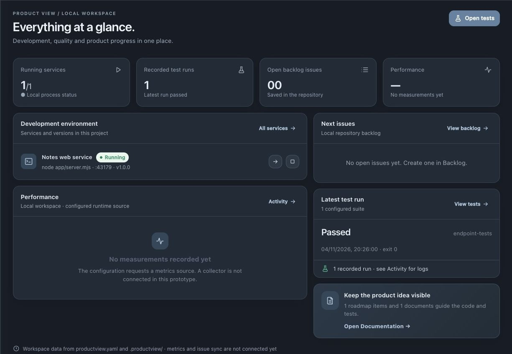

# Project Room

**Your control room for the software your agent builds.** See the plan. Run the app. Check the tests. Know what is happening as your product grows.

Project Room is a free, open-source macOS desktop app for local software projects. It puts the product vision, [GitHub Spec Kit](https://github.com/github/spec-kit) work, services, tests, data, API, CLI and MCP explorers, and recorded activity beside the code. A product owner can keep the direction visible while developers and coding agents work in the same repository.

[Website](https://openprojectroom.com/) · [Latest Mac release](https://github.com/OpenProjectRoom/desktop/releases/latest) · [Agent guide](agent/project-room/SKILL.md)

[](assets/screenshots/overview-readable.png)

The focused screenshot shows the **real included example** after starting its service and running its tests. Click it for the full window. Performance measurements and live GitHub/Linear issue sync are not implemented yet; the app labels those gaps.

## Try it in five minutes

1. Download the [Apple Silicon Mac preview](https://github.com/OpenProjectRoom/desktop/releases/latest/download/Project-Room-Desktop-arm64-mac.zip), unzip it, and move **Project Room.app** to Applications. This preview is unsigned and unnotarized, so macOS may require an explicit open in **System Settings → Privacy & Security**.
2. Have [Node.js 20+](https://nodejs.org/) installed for the working example's service and tests. The desktop app itself does not require Node.js.
3. Open the app and click **Try working example**. It copies a small project to `~/Documents/Project Room Examples/hello-workspace` and opens it without starting anything.
4. Start **Notes web service** in Services and open its local URL. Try `GET /health` and `GET /api/notes` in **API Explorer**. Run **Node endpoint tests** in Test Explorer, inspect `notes.json` in Data Explorer, then open the linked feature in Requirements.

The example is [here in the repository](examples/hello-workspace). It has a real Node service, local JSON storage, tests, a constitution, and standard Spec Kit `specs/001-notes/` artifacts. No account, database server, secret, or cloud deployment is needed.

| Product intent | Running software | Evidence |
| --- | --- | --- |
| Vision, roadmap, documentation, Spec Kit requirements and tasks | Project Map, manual service controls, API, CLI and MCP explorers, data viewers | Test results, HTTP responses, process output, activity history, local environment variable status |

<details><summary>See the real example views</summary>


</details>

## Use it with your own repository

Open a project folder in the desktop app. New projects store their shared configuration in `.projectroom/project.yaml`. The folder is hidden in Finder but committed to Git so every developer and agent gets the same setup. You do not need to mention the filename in everyday prompts: Project Room discovers it automatically, and its onboarding prompt tells an agent where to write it. Existing root-level `productview.yaml` files still open; move one to `.projectroom/project.yaml` when updating an older project, leaving only one configuration file. If no configuration exists yet, onboarding inspects local project files and prepares a prompt for your installed Codex CLI or Claude Code. The agent reads the [repository contract](PROJECT_ROOM.md), [agent skill](agent/project-room/SKILL.md), and [YAML schema](schemas/projectroom.schema.json), then records **verified** commands and components.

Keep product specifications in Spec Kit's normal `.specify/` and `specs/` files. Project Room reads them and adds optional traceability links in YAML; it does not create a second specification tree. Services, tests, data sources, MCP servers, and API requests run or connect only after a manual action. Local environment **values** stay outside the repository; YAML stores their names.

The packaged Blackbox Agent B workspace is an **interactive simulation**. Choose **Try working example** or open your own configured repository for real local actions. See the [getting started guide](docs/product/getting-started.md) and [architecture notes](docs/product/architecture.md) for the current behavior and boundaries.

## Develop from source

```sh
npm ci
npm test
npm run validate:config
npm start
```

On Apple Silicon macOS, `npm run package:mac:app` builds an app bundle. The first public releases are unsigned while Apple Developer signing and notarization are being set up. Windows and Linux packages have not been tested.

We welcome focused [bug reports and feature requests](https://github.com/OpenProjectRoom/desktop/issues), discussions about missing workflows, and pull requests. Read [CONTRIBUTING.md](CONTRIBUTING.md) first. For sensitive reports, see [SECURITY.md](SECURITY.md).

MIT licensed. See [LICENSE](LICENSE).
