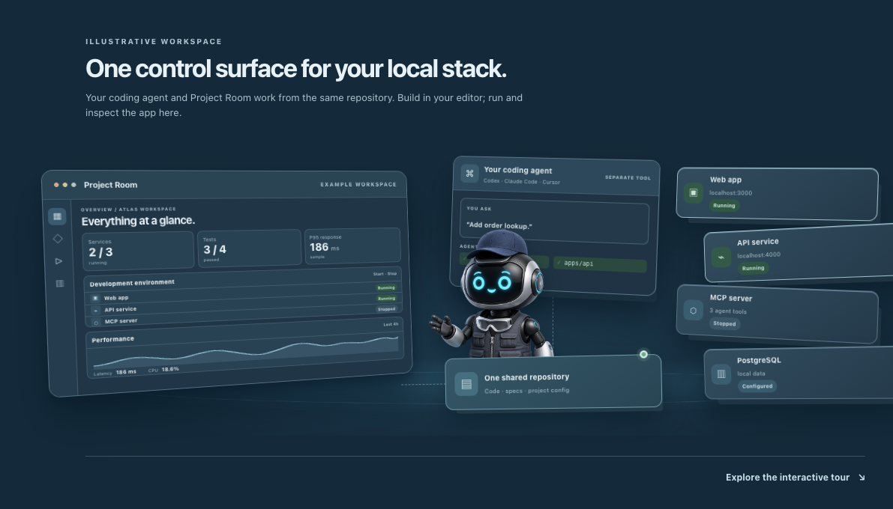

# Project Room

**Your agent builds the app. You keep the controls.**

Build in Codex, Claude Code, Cursor, or your usual editor. Project Room opens the **same local repository** and gives you one window to run the app, check tests, inspect data, and follow the product plan. It is a free, open-source macOS desktop app for people building software with coding agents and the teammates who need to understand that software later.

[**Download free for Mac**](https://github.com/OpenProjectRoom/desktop/releases/latest/download/Project-Room-Desktop-arm64-mac.zip) · [Connect an existing repository](#connect-an-existing-repository) · [Start a new app](#start-a-new-app) · [Watch the 60-second demo](#see-a-real-project-in-60-seconds)

If this is the control window you've been missing, click **Star** in the GitHub repository header. It saves Project Room for later and helps other builders discover it.

[](https://openprojectroom.com/#control-surface)

*Illustrative workspace. Your coding agent edits the repository; Project Room opens that same folder and gives you controls for the running app. [Explore the interactive tour](https://openprojectroom.com/#live-tour).*

## Get from download to your own workspace

1. **Download and open** the free [Apple Silicon Mac app](https://github.com/OpenProjectRoom/desktop/releases/latest/download/Project-Room-Desktop-arm64-mac.zip). Move **Project Room.app** to Applications.
2. **Open your project folder in Codex, Claude Code, Cursor, or your usual coding agent.** Paste the prompt for an [existing repository](#connect-an-existing-repository) or a [new app](#start-a-new-app). For an existing repository, the agent first summarizes what it found and waits for your answer before preparing `.projectroom/project.yaml`.
3. **Open that same folder in Project Room.** Review **Onboarding** and **Project Map**, then start one configured service and run one test. Nothing starts just because you opened the folder.

### Connect an existing repository

Use this in the coding agent already working in your repository. Spec Kit is optional here; your existing code, docs, and specs stay where they are.

<details><summary>Show the copyable existing-repository prompt</summary>

```text
Add Project Room to this repository. Read the agent guide (https://github.com/OpenProjectRoom/desktop/blob/main/agent/project-room/SKILL.md) first. Inspect the project without changing files. Summarize what you found, whether it uses GitHub Spec Kit, what Project Room could show, and what is uncertain. Ask only the decisions you cannot safely infer. Wait for my answer before creating or updating the configuration. Then follow the guide. Finish with the Mac download and installation steps, the exact folder to open in Project Room, and what I should verify there first.
```

</details>

### Start a new app

Use this in the folder where you want your new app. Replace the two bracketed placeholders with your idea and audience.

<details><summary>Show the copyable new-project prompt</summary>

```text
Build [my app idea] for [my audience] in this folder with Git, the official GitHub Spec Kit (https://github.com/github/spec-kit), and Project Room. First ask me who it is for, what problem it solves, and what the first useful release should do.

Read the Project Room guide (https://github.com/OpenProjectRoom/desktop/blob/main/agent/project-room/SKILL.md) and schema (https://github.com/OpenProjectRoom/desktop/blob/main/schemas/projectroom.schema.json). Keep the constitution, specs, plans, and tasks in Spec Kit's standard files. Create .projectroom/project.yaml from real code and commands as they appear; no parallel spec tree, invented components, or secrets. Use manual startup and validate the YAML.

Finish with the Mac download and installation steps, the exact folder to open in Project Room, what you configured, what remains uncertain, and what I should verify there first.
```

</details>

The [agent guide](agent/project-room/SKILL.md) and [YAML schema](schemas/projectroom.schema.json) describe the shared format. The [website](https://openprojectroom.com/#get-started) has copy buttons for both prompts.

## See a real project in 60 seconds

https://github.com/user-attachments/assets/8047f400-c1cb-4be7-8fe4-6177e5bdecf1

[Download the MP4](assets/demo/project-room-60s.mp4)

The film follows **download → open a repository → review the agent's findings → run and inspect the app**. Short English captions and closer views show the service changing state, its memory history, an MCP result, an API response, data, and passing tests. Setup scenes illustrate the recommended workflow. The app panels use captured screens from **Order Desk**, a separate local sample project. Camera moves and transitions are illustrated; this is not a recording of unattended agent activity. The website's [interactive tour](https://openprojectroom.com/#live-tour) is a separate labeled simulation.

[](assets/screenshots/order-desk-overview.png)

*Real Order Desk workspace: two services started manually, an actual test result, and CPU history sampled during that app session. Click for the full-size screenshot.*

## One repository, two ways to work

Your coding agent edits the code and [GitHub Spec Kit](https://github.com/github/spec-kit) files in the repository. Project Room reads that same repository, shows its product context, and runs **verified local commands only when you click**. It is a control surface beside your editor, with no need to move your code or specifications.

    You → Codex / Claude Code / Cursor → shared Git repository
                                          ↕
                                  Project Room Desktop
                                          ↓
                             Local services · tests · data

| You want to… | Open… | What you see or do |
| --- | --- | --- |
| Get your bearings | **Overview**, **Files**, **Onboarding** | Current services, recorded test runs, backlog, repository files, and which setup entries were actually found. |
| Keep the product direction visible | **Vision**, **Roadmap**, **North Star**, **Backlog**, **Documentation** | Markdown product context and repository-backed work. Vision, Roadmap, and North Star are optional navigation views. |
| Follow a Spec Kit feature | **Requirements** | Constitution, spec, plan, tasks, task checkboxes, requirement IDs, and links to configured components and recorded tests. |
| Understand and run the local stack | **Project Map**, **Services** | Services, databases, storage, dependencies, start/stop controls, logs, build identity, and CPU/memory history. |
| Explore interfaces | **API Explorer**, **MCP Explorer**, **CLI Explorer** | OpenAPI operations and responses; MCP tools, resources, and prompts; command help, arguments, and local output. |
| Inspect and verify | **Data Explorer**, **Test Explorer**, **Activity** | Read-only data previews, test suites and individual supported cases, plus recorded workspace events. |
| Set local values | **Environment** | Required variable names and values in the project's ignored <code>.env</code>; secrets stay out of the shared YAML. |

Product Chat is optional: connect a locally installed Codex CLI or Claude Code setup to ask about the open project. Your normal coding agent and editor remain your primary development tools.

## Follow the product from intent to evidence

Project Room keeps the *why* visible beside the running software. The product owner can edit a vision, maintain a local backlog and roadmap, and record one North Star outcome. The coding agent and developers can read the same files in Git.

[](assets/screenshots/order-desk-vision.png)

**Spec Kit stays in its standard files.** Project Room reads <code>.specify/</code> and <code>specs/</code> rather than creating a parallel specification tree. Requirements shows the feature artifacts and task progress; optional YAML links connect requirement IDs to real components and test suites. A checked task is not treated as proof that a service is running or a requirement passes.

[](assets/screenshots/order-desk-requirements.png)

## See and operate the local system

The Project Map contains runtime resources: services, databases, storage, and persistent command servers. Tests, specifications, and backlog items have their own views. Services start manually and show the command, current process state, build timestamp, commit, optional version, and output.

[](assets/screenshots/order-desk-project-map.png)

Project Room samples CPU and resident memory for services it starts, including child processes, every five seconds. The Overview combines their usage; Services shows a selected service's history. **Measurements live only in memory for this app session** and do not measure external processes, detached containers, disk usage, or API latency.

[](assets/screenshots/order-desk-services.png)

## Inspect the same application through every interface

In the Order Desk sample, the HTTP API, PostgreSQL tables, CLI command, and MCP tool all read the same order. Project Room makes each interface inspectable without treating one successful response as proof of every requirement.

| API Explorer | Data Explorer |
| --- | --- |
| [](assets/screenshots/order-desk-api.png) | [](assets/screenshots/order-desk-data.png) |
| Discover OpenAPI files, inspect operations and schemas, compose a request, and send it explicitly. | Inspect PostgreSQL, MySQL/MariaDB, SQLite, or local files with small, read-only previews. |

| CLI Explorer | MCP Explorer |
| --- | --- |
| [](assets/screenshots/order-desk-cli.png) | [](assets/screenshots/order-desk-mcp.png) |
| Discover likely project commands, read help on request, and run a bounded local trial after reviewing arguments. | Connect project MCP servers on request, browse advertised tools/resources/prompts, inspect schemas, and invoke an item deliberately. |

Test Explorer runs a configured suite or a supported individual Node/Rust test entry, then keeps the actual exit status and output. Its result is evidence of that command, not a fabricated coverage percentage.

[](assets/screenshots/order-desk-tests.png)

## Start with the included working example

1. Download the [Apple Silicon Mac preview](https://github.com/OpenProjectRoom/desktop/releases/latest/download/Project-Room-Desktop-arm64-mac.zip), unzip it, and move **Project Room.app** to Applications. The preview is unsigned and unnotarized; macOS may require an explicit open in **System Settings → Privacy & Security**.
2. Open Project Room and choose **Try working example**. It copies a small project to <code>~/Documents/Project Room Examples/hello-workspace</code> and opens it without starting a process.
3. With [Node.js 20+](https://nodejs.org/) installed, start **Notes web service**, inspect its API and JSON storage, run **Node endpoint tests**, and open the linked Spec Kit feature in **Requirements**. Node is needed for this example's commands, not for the desktop app itself.

The [included example](examples/hello-workspace) has a real service, tests, local JSON storage, a constitution, and Spec Kit feature files. It needs no account, database server, or cloud deployment. The separate **Order Desk** screenshots above show a richer project with PostgreSQL, CLI, and MCP interfaces; Order Desk is not bundled with the desktop download.

## What the setup adds

Project Room's shared `.projectroom/project.yaml` belongs in your repository alongside the code. It points to verified services, tests, data sources, tools, and product documents. Secret values stay in the project's ignored `.env`. The app scans a folder for clues, while your coding agent can create or refine the YAML after inspecting the repository. **Configured does not mean running or tested**: check the entries in Project Room and run what you need. See the [repository contract](PROJECT_ROOM.md) for the full format and behavior.

## Current boundaries

Project Room is a **local development workspace**, not a cloud deployment platform. Processes, requests, tests, MCP connections, and data inspection require deliberate actions. The packaged browser demo and website tour use labeled sample data. Live GitHub/Linear issue synchronization, external telemetry adapters, database editing, and arbitrary SQL are not part of the current preview. The first public macOS builds are unsigned; Windows and Linux packages have not been tested.

## Develop and contribute

    npm ci
    npm test
    npm run validate:config
    npm start

On Apple Silicon macOS, <code>npm run package:mac:app</code> builds an unsigned local app bundle. The [signed release workflow](docs/product/mac-releases.md) is prepared: once Apple signing and notarization secrets are configured, a matching `v` tag builds the DMG and ZIP, publishes update metadata, and enables the in-app **Restart to update** banner for subsequent versions. The current public preview remains unsigned until that first signed release is published. Read [CONTRIBUTING.md](CONTRIBUTING.md) before a pull request; use [Issues](https://github.com/OpenProjectRoom/desktop/issues) for focused bugs and feature requests and [SECURITY.md](SECURITY.md) for sensitive reports.

MIT licensed. See [LICENSE](LICENSE).
